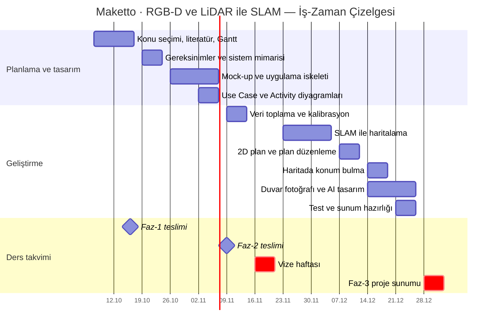

# Maketto — İş-Zaman Çizelgesi (Gantt)

- **Ders:** Mobil Programlama, 2026–27 Güz
- **Proje konusu:** RGB-D ve LiDAR ile SLAM
- **Proje:** Maketto — telefonla evi tara, planı düzenle, evde konumunu haritada bul, bir duvarın fotoğrafını çek ve o duvar için AI tasarım al.
- **Referans makale:** Yan vd., *RGB-D SLAM: A Review of Methods and Performance Trade-Offs for Different Requirements*, Sensors 2026, 26(11), 3513. [doi:10.3390/s26113513](https://doi.org/10.3390/s26113513)

Rapor ve sunum için görsel: [`docs/gantt.png`](docs/gantt.png)

| Hafta | Tarih | İş | Çıktı |
|---|---|---|---|
| H2–H3 | 7–16 Ekim | Konu seçimi, literatür, Gantt | **Faz-1 teslimi** |
| H4 | 19–23 Ekim | Gereksinimler ve sistem mimarisi | Mimari şema |
| H5–H6 | 26 Ekim – 6 Kasım | Mock-up ve uygulama iskeleti | Ekranlar ve geçişler |
| H6 | 2–6 Kasım | Use Case ve Activity diyagramları | **Faz-2 teslimi** (9 Kasım) |
| H7 | 9–13 Kasım | Veri toplama (RGB-D + LiDAR) ve kalibrasyon | Kayıtlı tarama verisi |
| H8 | 16–20 Kasım | Vize haftası | — |
| H9–H10 | 23 Kasım – 4 Aralık | SLAM ile haritalama | Evin 3B haritası |
| H11 | 7–11 Aralık | 2D plan çıkarma ve plan düzenleme | Düzenlenebilir plan |
| H12 | 14–18 Aralık | Haritada konum bulma | Planda "buradasınız" |
| H12–H13 | 14–25 Aralık | Duvar fotoğrafı ve AI tasarım | AI tasarım görseli |
| H13 | 21–25 Aralık | Test ve sunum hazırlığı | Çalışan uygulama |
| H14 | 28 Aralık – 1 Ocak | Proje sunumu | **Faz-3 teslimi** |
