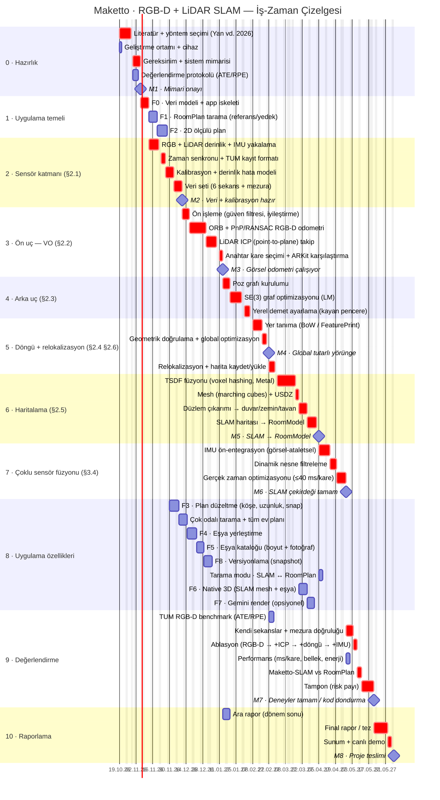

# Maketto — İş-Zaman Çizelgesi (Gantt)

- **Proje isteri:** RGB-D ve LiDAR ile SLAM
- **Referans makale:** Yan, Y.; Li, J.; Liu, Q.; Lv, S.; Wu, Q. *RGB-D SLAM: A Review of Methods and Performance Trade-Offs for Different Requirements.* Sensors 2026, 26(11), 3513. [doi:10.3390/s26113513](https://doi.org/10.3390/s26113513)
- **Proje:** Maketto — LiDAR'lı iPhone ile evi tarayıp ölçülü 2D plan ve 3B model çıkaran, eşya yerleştirmeli ev tasarım uygulaması (bkz. `PLAN.md`).

Plan, projeye **sıfırdan** başlanıyormuş gibi kuruldu: uygulama iskeleti (F0) dahil her iş planlandı. SLAM, makaledeki RGB-D SLAM çerçevesinin modüllerine (§2.1–§2.6, §3.4) bölündü ve kritik yol yapıldı. Uygulama özellikleri (`PLAN.md`'deki F0–F8) ona paralel ilerliyor.

## Varsayımlar
- **Takvim:** 19 Ekim 2026 (Pzt) → 4 Haziran 2027 (Cum), yaklaşık 33 hafta. Kritik yol 156 iş günü, toplam iş yükü 220 iş günü.
- **Süreler iş günüdür.** Hafta sonları ve resmi tatiller hariç: 29 Ekim, 1 Ocak, Ramazan Bayramı (9–11 Mart), 23 Nisan, Kurban Bayramı (17–19 Mayıs; 19 Mayıs ile çakışıyor).
- **Donanım:** iPhone 14 Pro Max. RGB kamera + LiDAR derinliği (dToF, makaledeki TOF sınıfı) + IMU. RGB-D çifti ARKit `sceneDepth` ile alınır.
- **İki iz:** **İz A, SLAM** (kırmızı, kritik yol) ve **İz B, uygulama özellikleri** (mavi). İz B yalnızca `RoomModel` sözleşmesine bağlı olduğu için mock veriyle bağımsız ilerler. Tek kişilik ekipte İz B, A'daki veri toplama ve deney beklemelerine yayılmalı. Tümü sırayla yapılırsa takvim yaklaşık 12 hafta uzar (F7 çıkarılırsa biraz daha az).
- **Tarih kaydırma:** Yalnızca `lit` ve `env` satırlarındaki başlangıç tarihini değiştirmek yeter. Diğer her şey `after` bağımlılıklarıyla kendiliğinden kayar.

## Gantt şeması
GitHub bu bloğu doğrudan çizer (dikey kırmızı çizgi bugünü gösterir). Rapor ve sunum için hazır görsel: [`docs/gantt.png`](docs/gantt.png).

> Mermaid, hafta sonuna denk gelen bitişleri çubuğa dahil eder ve kilometre taşını bir sonraki iş gününe çizer. Aşağıdaki tablolardaki tarihler gerçek iş günleridir.

## Kilometre taşları

| # | Kilometre taşı | Tarih | Kanıt |
|---|---|---|---|
| M1 | Mimari ve yöntem seçimi onayı | 5 Kasım 2026 | Mimari doküman + yöntem karşılaştırma tablosu |
| M2 | Veri yakalama + kalibrasyon hazır | 10 Aralık 2026 | TUM formatında 6 sekans + kalibrasyon raporu |
| M3 | Görsel odometri çalışıyor | 13 Ocak 2027 | TUM fr1/desk ATE RMSE < 5 cm, ara rapor |
| M4 | Global tutarlı yörünge | 19 Şubat 2027 | Tüm ev döngüsünde kapanış hatası < 5 cm |
| M5 | SLAM → RoomModel | 2 Nisan 2027 | SLAM'den üretilen plan uygulamada çiziliyor, duvarlar mezurayla < 5 cm |
| M6 | SLAM çekirdeği tamam | 27 Nisan 2027 | IMU füzyonu + takip ≤ 40 ms/kare |
| M7 | Deneyler tamam / kod dondurma | 20 Mayıs 2027 | Benchmark, ablasyon ve RoomPlan karşılaştırma tabloları |
| M8 | Proje teslimi | 4 Haziran 2027 | Final rapor + canlı demo |

## Makale → iş paketi eşlemesi

| Makale | Konu | Maketto'daki karşılığı | Seçilen yaklaşım |
|---|---|---|---|
| §2.1 | RGB-D kamera, kalibrasyon | 2 · Sensör katmanı | LiDAR (dToF) derinliği + RGB + IMU; iç/dış parametre doğrulaması, derinlik hata modeli |
| §2.2 | Ön uç (görsel odometri) | 3 · Ön uç | Öznitelik tabanlı (ORB + PnP/RANSAC); az dokulu sahnede LiDAR ICP |
| §2.3 | Arka uç | 4 · Arka uç | Filtre yerine graf optimizasyonu (doğrusal olmayan hareket ve büyük sahnede daha doğru) |
| §2.4 | Döngü kapama | 5 · Döngü + relokalizasyon | BoW / global tanımlayıcı + geometrik doğrulama |
| §2.5 | Haritalama | 6 · Haritalama | Yoğun TSDF → mesh; düzlemlerden metrik + semantik `RoomModel` |
| §2.6 | Relokalizasyon | 5 · Döngü + relokalizasyon | Anahtar kare veritabanı + harita kaydet/yükle |
| §3.4 | Çoklu sensör füzyonu | 7 · Çoklu sensör füzyonu | Görsel-ataletsel (IMU) füzyon + dinamik nesne filtreleme |
| §4, Tablo 3–4 | Değerlendirme, ödünleşimler | 9 · Değerlendirme | ATE/RPE RMSE (TUM RGB-D), ms/kare, ablasyon |

**Yöntem seçiminin gerekçesi (makale §4):** Makale iç mekân ve statik sahne için öznitelik tabanlı yöntemleri (ORB-SLAM2/3 çizgisi), az dokulu sahneler için doğrudan/geometrik yöntemleri, büyük ölçek için IMU ya da LiDAR entegrasyonunu öneriyor. Nöral örtük yöntemleri (NeRF, 3DGS) ise kaynakları kısıtlı platformlarda önermiyor. Bu yüzden ORB + LiDAR ICP + IMU hattı seçildi, nöral örtük haritalama kapsam dışı bırakıldı.

## İş paketleri
Kalın satırlar kritik yoldadır. Süre iş günü (g) cinsindendir.

### 0 · Hazırlık

| ID | İş paketi | Tarih | Süre | Başarı ölçütü |
|---|---|---|---|---|
| `lit` | **Literatür + yöntem seçimi (Yan vd. 2026)** | 19 Eki – 28 Eki | 8 g | Makaledeki 5 paradigmanın (öznitelik, doğrudan, nöral örtük, hibrit, çoklu sensör) karşılaştırma tablosu + seçilen yöntemin gerekçesi |
| `env` | Geliştirme ortamı + cihaz | 19 Eki – 20 Eki | 2 g | Boş proje XcodeGen → Xcode → iPhone 14 Pro Max üzerinde çalışıyor |
| `req` | **Gereksinim + sistem mimarisi** | 30 Eki – 05 Kas | 5 g | Mimari doküman: sensör → ön uç → arka uç → döngü → harita modülleri ve RoomModel JSON sözleşmesi |
| `evalp` | Değerlendirme protokolü (ATE/RPE) | 30 Eki – 03 Kas | 3 g | Metrikler (ATE/RPE RMSE, ms/kare, bellek), veri setleri (TUM RGB-D + kendi), referans (mezura, ARKit VIO) tanımlı |

### 1 · Uygulama temeli

| ID | İş paketi | Tarih | Süre | Başarı ölçütü |
|---|---|---|---|---|
| `f0` | **F0 · Veri modeli + app iskeleti** | 06 Kas – 12 Kas | 5 g | Ev → Oda → Versiyon modeli, SwiftData kalıcılığı, navigasyon; mock RoomModel listeleniyor |
| `f1` | F1 · RoomPlan tarama (referans/yedek) | 13 Kas – 19 Kas | 5 g | RoomPlan ile tara → RoomModel; duvar ölçüsü mezurayla farkı < 5 cm (SLAM için referans + yedek yol) |
| `f2` | F2 · 2D ölçülü plan | 20 Kas – 27 Kas | 6 g | Elle yazılmış RoomModel JSON → doğru oranlı, ölçü etiketli 2D plan |

### 2 · Sensör katmanı (§2.1)

| ID | İş paketi | Tarih | Süre | Başarı ölçütü |
|---|---|---|---|---|
| `cap` | **RGB + LiDAR derinlik + IMU yakalama** | 13 Kas – 20 Kas | 6 g | RGB + 256×192 LiDAR derinlik (60 Hz) + güven haritası + IMU diske yazılıyor; kare kaybı < %1 |
| `sync` | **Zaman senkronu + TUM kayıt formatı** | 23 Kas – 26 Kas | 4 g | Ortak zaman damgası; TUM formatında dışa aktarım (rgb/depth/imu/groundtruth.txt, referans = ARKit VIO pozu) |
| `calib` | **Kalibrasyon + derinlik hata modeli** | 27 Kas – 03 Ara | 5 g | İç parametreler doğrulandı, RGB↔derinlik hizalama hatası < 1 px, 0,3–5 m için mesafeye bağlı derinlik hata modeli |
| `data` | **Veri seti (6 sekans + mezura)** | 04 Ara – 10 Ara | 5 g | ≥ 6 sekans: oda, koridor, tüm ev döngüsü, az dokulu, düşük ışık, dinamik + her biri için mezura ölçümleri |

### 3 · Ön uç — VO (§2.2)

| ID | İş paketi | Tarih | Süre | Başarı ölçütü |
|---|---|---|---|---|
| `pre` | **Ön işleme (güven filtresi, iyileştirme)** | 11 Ara – 16 Ara | 4 g | Düşük güvenli/uzak derinlik maskesi, delik doldurma, düşük ışık iyileştirme; öncesi/sonrası karşılaştırma |
| `orb` | **ORB + PnP/RANSAC RGB-D odometri** | 17 Ara – 30 Ara | 10 g | ORB çıkarım/eşleme + derinlikle 3B–2B PnP/RANSAC; TUM fr1/desk ATE RMSE < 5 cm |
| `icp` | **LiDAR ICP (point-to-plane) takip** | 31 Ara – 08 Oca | 6 g | Point-to-plane ICP ile az dokulu (beyaz duvar) sekansta takip sürüyor; ORB yetersizken devreye giriyor |
| `kf` | **Anahtar kare seçimi + ARKit karşılaştırma** | 11 Oca – 13 Oca | 3 g | Anahtar kare politikası; ARKit VIO pozuna göre sapma raporu (yol uzunluğunun < %2’si) |

### 4 · Arka uç (§2.3)

| ID | İş paketi | Tarih | Süre | Başarı ölçütü |
|---|---|---|---|---|
| `pg` | **Poz grafı kurulumu** | 14 Oca – 19 Oca | 4 g | Düğüm = anahtar kare pozu, kenar = VO/ICP göreli poz + bilgi matrisi |
| `opt` | **SE(3) graf optimizasyonu (LM)** | 20 Oca – 29 Oca | 8 g | SE(3) Levenberg–Marquardt (g2o/GTSAM ya da Swift çözücü); yalnız VO’ya göre ATE’de ≥ %20 iyileşme |
| `ba` | **Yerel demet ayarlama (kayan pencere)** | 01 Şub – 05 Şub | 5 g | Kayan pencereli yerel demet ayarlama; yeniden projeksiyon hatası raporu |

### 5 · Döngü + relokalizasyon (§2.4 §2.6)

| ID | İş paketi | Tarih | Süre | Başarı ölçütü |
|---|---|---|---|---|
| `pr` | **Yer tanıma (BoW / FeaturePrint)** | 08 Şub – 15 Şub | 6 g | BoW (DBoW2) ya da Vision FeaturePrint ile döngü adayı; precision–recall eğrisi |
| `gv` | **Geometrik doğrulama + global optimizasyon** | 16 Şub – 19 Şub | 4 g | RANSAC + ICP doğrulama → döngü kenarı → global optimizasyon; tüm ev döngüsünde kapanış hatası < 5 cm, yanlış döngü = 0 |
| `reloc` | **Relokalizasyon + harita kaydet/yükle** | 22 Şub – 26 Şub | 5 g | Takip kaybında anahtar kare veritabanından yeniden konumlama < 2 s; harita kaydet/yükle ile oturumlar arası devam |

### 6 · Haritalama (§2.5)

| ID | İş paketi | Tarih | Süre | Başarı ölçütü |
|---|---|---|---|---|
| `tsdf` | **TSDF füzyonu (voxel hashing, Metal)** | 01 Mar – 15 Mar | 8 g | Voxel hashing TSDF (Metal, 2 cm voksel) ile yoğun 3B harita, oda ölçeğinde gerçek zamanlı füzyon |
| `mesh` | **Mesh (marching cubes) + USDZ** | 16 Mar – 18 Mar | 3 g | Marching cubes → mesh → USDZ dışa aktarım (F6 girdisi) |
| `plane` | **Düzlem çıkarımı → duvar/zemin/tavan** | 19 Mar – 25 Mar | 5 g | RANSAC düzlem çıkarımı + Manhattan hizalama → duvar / zemin / tavan + kapı-pencere boşlukları |
| `rm` | **SLAM haritası → RoomModel** | 26 Mar – 02 Nis | 6 g | SLAM haritası → RoomModel JSON; F2 çizicisi değişmeden çiziyor; duvar uzunlukları mezurayla < 5 cm |

### 7 · Çoklu sensör füzyonu (§3.4)

| ID | İş paketi | Tarih | Süre | Başarı ölçütü |
|---|---|---|---|---|
| `imu` | **IMU ön-entegrasyon (görsel-ataletsel)** | 05 Nis – 13 Nis | 7 g | IMU ön-entegrasyon kenarları grafa eklendi; hızlı hareket sekansında takip kaybı sayısı azalıyor |
| `dyn` | **Dinamik nesne filtreleme** | 14 Nis – 19 Nis | 4 g | Kişi / hareketli nesne maskesi (Vision segmentasyonu); dinamik sekansta ATE iyileşiyor |
| `rt` | **Gerçek zaman optimizasyonu (≤40 ms/kare)** | 20 Nis – 27 Nis | 5 g | Metal + çok iş parçacığı; takip ≤ 40 ms/kare (makale Tablo 3 aralığı), 10 dk taramada termal kısıtlama yok |

### 8 · Uygulama özellikleri

| ID | İş paketi | Tarih | Süre | Başarı ölçütü |
|---|---|---|---|---|
| `f3` | F3 · Plan düzeltme (köşe, uzunluk, snap) | 30 Kas – 07 Ara | 6 g | Köşe sürükle / uzunluk yaz / snap → komşu köşeler ve ölçüler tutarlı güncelleniyor |
| `multi` | Çok odalı tarama + tüm ev planı | 08 Ara – 14 Ara | 5 g | Çok odalı tarama, odaların otomatik ayrılması, tüm ev planı tek seferde çiziliyor |
| `f4` | F4 · Eşya yerleştirme | 15 Ara – 22 Ara | 6 g | “L koltuk 260×200” plana doğru ölçekle yerleşiyor, döndürülebiliyor |
| `f5` | F5 · Eşya kataloğu (boyut + fotoğraf) | 23 Ara – 28 Ara | 4 g | Boyut + fotoğraflı yeni eşya → katalogda → plana yerleştirilebiliyor |
| `f8` | F8 · Versiyonlama (snapshot) | 29 Ara – 04 Oca | 4 g | v1 → değiştir → v2 kaydet → v1’e dön: v1 birebir geri geliyor |
| `mode` | Tarama modu · SLAM ↔ RoomPlan | 05 Nis – 07 Nis | 3 g | Tarama ekranında Maketto-SLAM / RoomPlan seçimi; ikisi de aynı RoomModel sözleşmesini üretiyor |
| `f6` | F6 · Native 3D (SLAM mesh + eşya) | 19 Mar – 25 Mar | 5 g | SLAM mesh’i + eşyalar 3B’de; boyutlar 2D planla birebir |
| `f7` | F7 · Gemini render (opsiyonel) | 26 Mar – 31 Mar | 4 g | Plan görselinden Gemini stil render’ı (yalnız sunum katmanı, ölçüye bağlı değil) — zaman kalırsa |

### 9 · Değerlendirme

| ID | İş paketi | Tarih | Süre | Başarı ölçütü |
|---|---|---|---|---|
| `bench` | TUM RGB-D benchmark (ATE/RPE) | 22 Şub – 25 Şub | 4 g | TUM fr1/desk, fr2/xyz, fr3/long_office için ATE/RPE RMSE; ORB-SLAM3 / RTAB-Map ile karşılaştırma tablosu |
| `own` | **Kendi sekanslar + mezura doğruluğu** | 28 Nis – 03 May | 4 g | Yörünge (ARKit referansı) ve duvar ölçüleri (mezura) için doğruluk tablosu |
| `abl` | **Ablasyon (RGB-D → +ICP → +döngü → +IMU)** | 04 May – 06 May | 3 g | LiDAR ICP, döngü kapama ve IMU’nun ATE’ye katkısı ayrı ayrı ölçüldü |
| `perf` | Performans (ms/kare, bellek, enerji) | 28 Nis – 30 Nis | 3 g | iPhone 14 Pro Max’te ms/kare, bellek, enerji ve sıcaklık ölçümleri |
| `rpcmp` | **Maketto-SLAM vs RoomPlan** | 07 May – 10 May | 2 g | Ölçü doğruluğu, tarama süresi ve başarısızlık durumlarında karşılaştırma tablosu |
| `buf` | **Tampon (risk payı)** | 11 May – 20 May | 5 g | Kayan işler kapandı; bu noktadan sonra yeni özellik eklenmiyor |

### 10 · Raporlama

| ID | İş paketi | Tarih | Süre | Başarı ölçütü |
|---|---|---|---|---|
| `int` | Ara rapor (dönem sonu) | 14 Oca – 19 Oca | 4 g | Literatür, mimari, sensör katmanı ve VO sonuçlarını içeren rapor teslim edildi |
| `final` | **Final rapor / tez** | 21 May – 01 Haz | 8 g | Yöntem, deneyler ve tartışma (makale §4’teki ödünleşimler üzerinden) teslim edildi |
| `demo` | **Sunum + canlı demo** | 02 Haz – 04 Haz | 3 g | Canlı akış: oda tara → SLAM → plan → eşya → 3B |

## Riskler

| Risk | Etki | Önlem |
|---|---|---|
| Cam, ayna ve parlak yüzeylerde LiDAR hatası (makale §4) | Hayalet duvar, ölçü hatası | Güven filtresi (`pre`), düzlem + Manhattan önseli (`plane`), RoomPlan yedek yolu (`f1`) |
| Az dokulu beyaz duvarlar | ORB takibi kopar | LiDAR ICP (`icp`), düzlem öznitelikleri |
| Dar görüş alanı, ~5 m LiDAR menzili | Geniş salonda sürüklenme | Sık anahtar kare, IMU füzyonu (`imu`), döngü kapama (`gv`) |
| Hareketli insan / evcil hayvan | Yanlış eşleşme, kirli harita | Segmentasyon maskesi (`dyn`) |
| Mobil işlem gücü ve ısınma | FPS düşer, termal kısıtlama | Metal, asenkron haritalama, voksel boyutu ayarı (`rt`) |
| Kapsam / zaman | Teslim kayar | 5 g tampon (`buf`), F7 opsiyonel, İz B kritik yolun dışında |

---
PNG'yi yeniden üretmek için Mermaid bloğunu <https://mermaid.live> adresine yapıştırıp dışa aktarın ya da:
`npx -p @mermaid-js/mermaid-cli mmdc -i GANTT.md -o docs/gantt.png -w 2000 -s 2 -b white && mv docs/gantt-1.png docs/gantt.png`
