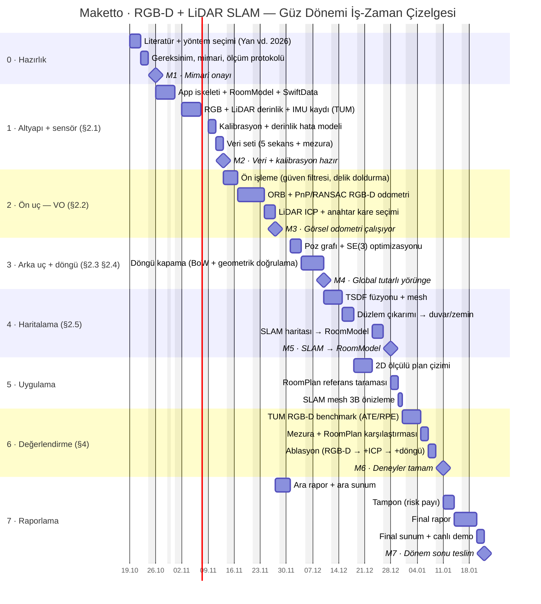

# Maketto — Güz Dönemi İş-Zaman Çizelgesi (Gantt)

- **Proje isteri:** RGB-D ve LiDAR ile SLAM
- **Referans makale:** Yan, Y.; Li, J.; Liu, Q.; Lv, S.; Wu, Q. *RGB-D SLAM: A Review of Methods and Performance Trade-Offs for Different Requirements.* Sensors 2026, 26(11), 3513. [doi:10.3390/s26113513](https://doi.org/10.3390/s26113513)
- **Proje:** Maketto — LiDAR'lı iPhone ile evi tarayıp ölçülü 2D plan ve 3B model çıkaran ev tasarım uygulaması (bkz. `PLAN.md`).

Plan, projeye sıfırdan başlanıyormuş gibi ve **tek bir üniversite dönemine (14 hafta)** sığacak şekilde kuruldu. Uygulama iskeleti dahil her iş planlandı. SLAM, makaledeki RGB-D SLAM çerçevesinin modüllerine (§2.1–§2.5) bölündü. Her modül bir öncekinin çıktısını kullandığı için iş sırası da bu çerçeveyi izliyor.

## Varsayımlar
- **Dönem:** 2026–27 güz dönemi, 19 Ekim 2026 (Pzt) → 22 Ocak 2027 (Cum), 14 hafta (H1–H14). Final sınav haftaları bu sürenin dışında.
- **Kapasite:** 68 iş günü (hafta sonları, 29 Ekim ve 1 Ocak hariç). Plan 67 iş günü tutuyor, 3 günlük tampon dahil.
- **Ekip:** Tek kişi, işler sırayla yapılıyor. Bir iş gecikirse teslim de kayar; bunu tampon karşılıyor.
- **Donanım ve yazılım:** iPhone 14 Pro Max (RGB kamera + LiDAR dToF derinliği + IMU) veriyi toplar ve sonucu gösterir. SLAM hattı bilgisayarda Python + OpenCV + Open3D ile çevrimdışı çalışır.
- **Tarih kaydırma:** Yalnızca `lit` satırındaki başlangıç tarihini değiştirmek yeter, diğer her şey `after` bağımlılıklarıyla kayar. Bahar dönemine taşınırsa `excludes` satırına o dönemin tatilleri (Ramazan Bayramı 9–11 Mart, 23 Nisan, Kurban Bayramı 17–19 Mayıs) eklenmeli.

## Kapsam kararları
Makale (§5), zor koşullarda RGB-D SLAM'in gerçek zamandan çok doğruluk ve sağlamlığı öne aldığını söylüyor. Bir dönemde hem SLAM hattını hem mobil gerçek zaman optimizasyonunu yetiştirmek gerçekçi olmadığı için hat önce bilgisayarda çevrimdışı doğrulanıyor.

| Kapsam dışı | Neden |
|---|---|
| Cihazda gerçek zamanlı SLAM (Metal) | Bir döneme sığmıyor; hat önce çevrimdışı doğrulanıyor |
| IMU füzyonu (§3.4) | İster RGB-D + LiDAR; IMU ek sensör. Veri zaten kaydediliyor (`cap`), sonra eklenebilir |
| Relokalizasyon (§2.6) | Çevrimdışı işlemede kritik değil; takibi kopan sekans yeniden çekilir |
| Dinamik nesne filtreleme | Sekanslar boş odada çekilecek |
| Nöral örtük haritalama (NeRF, 3DGS) | Makale (§4) kısıtlı platformlarda önermiyor |
| Plan düzeltme, eşya yerleştirme, katalog, versiyonlama, Gemini render, çok odalı tarama (`PLAN.md` F3–F8) | SLAM isteriyle ilgili değil; sonraki dönem |

## Gantt şeması
GitHub bu bloğu doğrudan çizer (dikey kırmızı çizgi bugünü gösterir). Rapor ve sunum için hazır görsel: [`docs/gantt.png`](docs/gantt.png).

> Mermaid, hafta sonuna denk gelen bitişleri çubuğa dahil eder ve kilometre taşını bir sonraki iş gününe çizer. Aşağıdaki tablolardaki tarihler gerçek iş günleridir.

## Kilometre taşları

| # | Kilometre taşı | Hafta | Tarih | Kanıt |
|---|---|---|---|---|
| M1 | Mimari onayı | H1 | 23 Ekim 2026 | Mimari doküman + yöntem karşılaştırması |
| M2 | Veri + kalibrasyon hazır | H4 | 12 Kasım 2026 | TUM formatında 5 sekans + kalibrasyon raporu |
| M3 | Görsel odometri çalışıyor | H6 | 26 Kasım 2026 | TUM fr1/desk ATE RMSE < 5 cm; ardından ara rapor (30 Kasım) |
| M4 | Global tutarlı yörünge | H8 | 9 Aralık 2026 | Ev içi döngüde kapanış hatası < 5 cm |
| M5 | SLAM → RoomModel | H10 | 25 Aralık 2026 | SLAM'den çıkan plan uygulamada çiziliyor, duvarlar mezurayla < 5 cm |
| M6 | Deneyler tamam | H12 | 8 Ocak 2027 | Benchmark, mezura/RoomPlan ve ablasyon tabloları |
| M7 | Dönem sonu teslim | H14 | 21 Ocak 2027 | Final rapor + canlı demo |

## Makale → iş paketi eşlemesi

| Makale | Konu | Plandaki karşılığı | Seçilen yaklaşım |
|---|---|---|---|
| §2.1 | RGB-D kamera, kalibrasyon | 1 · Altyapı + sensör | LiDAR (dToF) derinliği + RGB; hizalama doğrulaması, derinlik hata modeli |
| §2.2 | Ön uç (görsel odometri) | 2 · Ön uç | ORB + PnP/RANSAC; az dokulu duvarda LiDAR ICP |
| §2.3 | Arka uç | 3 · Arka uç + döngü | Filtre yerine graf optimizasyonu (büyük sahnede daha doğru) |
| §2.4 | Döngü kapama | 3 · Arka uç + döngü | BoW / global tanımlayıcı + geometrik doğrulama |
| §2.5 | Haritalama | 4 · Haritalama | TSDF → mesh; düzlemlerden metrik `RoomModel` |
| §2.6 | Relokalizasyon | Kapsam dışı | — |
| §3.4 | Çoklu sensör füzyonu | 2 · Ön uç | RGB öznitelikleri ile LiDAR geometrisi birlikte kullanılıyor; IMU kapsam dışı |
| §4, Tablo 3–4 | Değerlendirme, ödünleşimler | 6 · Değerlendirme | ATE/RPE RMSE (TUM RGB-D), mezura, ablasyon |

**Yöntem seçiminin gerekçesi (makale §4):** Makale iç mekân ve statik sahne için öznitelik tabanlı yöntemleri (ORB-SLAM2/3 çizgisi), az dokulu sahneler için doğrudan/geometrik yöntemleri, büyük ölçek için LiDAR ya da IMU entegrasyonunu öneriyor. Bu yüzden ORB + LiDAR ICP + graf optimizasyonu hattı seçildi.

## İş paketleri
Süre iş günü (g) cinsinden; H, dönem haftasıdır.

### 0 · Hazırlık

| ID | İş paketi | Hafta | Tarih | Süre | Başarı ölçütü |
|---|---|---|---|---|---|
| `lit` | Literatür + yöntem seçimi (Yan vd. 2026) | H1 | 19 Eki – 21 Eki | 3 g | Makaledeki 5 paradigmanın (öznitelik, doğrudan, nöral örtük, hibrit, çoklu sensör) karşılaştırması + seçilen hattın gerekçesi |
| `req` | Gereksinim, mimari, ölçüm protokolü | H1 | 22 Eki – 23 Eki | 2 g | Mimari (iPhone kaydı → masaüstü SLAM hattı → RoomModel JSON → uygulama) ve metrikler (ATE/RPE RMSE, mezura farkı) yazılı |

### 1 · Altyapı + sensör (§2.1)

| ID | İş paketi | Hafta | Tarih | Süre | Başarı ölçütü |
|---|---|---|---|---|---|
| `f0` | App iskeleti + RoomModel + SwiftData | H2 | 26 Eki – 30 Eki | 4 g | Proje XcodeGen → Xcode → iPhone’da çalışıyor; Ev → Oda modeli, SwiftData, mock RoomModel listeleniyor |
| `cap` | RGB + LiDAR derinlik + IMU kaydı (TUM) | H3 | 02 Kas – 06 Kas | 5 g | RGB + 256×192 LiDAR derinlik (60 Hz) + güven haritası + IMU + ARKit pozu ortak zaman damgasıyla TUM formatında dışa aktarılıyor |
| `calib` | Kalibrasyon + derinlik hata modeli | H4 | 09 Kas – 10 Kas | 2 g | İç parametreler doğrulandı, RGB↔derinlik hizalama hatası < 1 px, mesafeye bağlı derinlik hata modeli (0,3–5 m) |
| `data` | Veri seti (5 sekans + mezura) | H4 | 11 Kas – 12 Kas | 2 g | ≥ 5 sekans (oda, koridor, ev içi döngü, az dokulu duvar, düşük ışık) + her biri için mezura ölçümleri |

### 2 · Ön uç — VO (§2.2)

| ID | İş paketi | Hafta | Tarih | Süre | Başarı ölçütü |
|---|---|---|---|---|---|
| `pre` | Ön işleme (güven filtresi, delik doldurma) | H4–H5 | 13 Kas – 16 Kas | 2 g | Düşük güvenli ve uzak derinlik maskesi, delik doldurma; öncesi/sonrası karşılaştırma |
| `vo` | ORB + PnP/RANSAC RGB-D odometri | H5–H6 | 17 Kas – 23 Kas | 5 g | ORB çıkarım/eşleme + derinlikle PnP/RANSAC; TUM fr1/desk ATE RMSE < 5 cm |
| `icp` | LiDAR ICP + anahtar kare seçimi | H6 | 24 Kas – 26 Kas | 3 g | Point-to-plane ICP ile az dokulu sekansta takip sürüyor; anahtar kare politikası belirlendi |

### 3 · Arka uç + döngü (§2.3 §2.4)

| ID | İş paketi | Hafta | Tarih | Süre | Başarı ölçütü |
|---|---|---|---|---|---|
| `pg` | Poz grafı + SE(3) optimizasyonu | H7 | 01 Ara – 03 Ara | 3 g | Düğüm = anahtar kare pozu, kenar = VO/ICP göreli pozu; LM optimizasyonu (Open3D / g2o) yalnız VO’ya göre ATE’yi düşürüyor |
| `lc` | Döngü kapama (BoW + geometrik doğrulama) | H7–H8 | 04 Ara – 09 Ara | 4 g | BoW ya da global tanımlayıcıyla döngü adayı + RANSAC/ICP doğrulama; ev içi döngüde kapanış hatası < 5 cm, yanlış döngü = 0 |

### 4 · Haritalama (§2.5)

| ID | İş paketi | Hafta | Tarih | Süre | Başarı ölçütü |
|---|---|---|---|---|---|
| `tsdf` | TSDF füzyonu + mesh | H8–H9 | 10 Ara – 14 Ara | 3 g | TSDF füzyonu (2 cm voksel) → mesh (PLY/USDZ) |
| `plane` | Düzlem çıkarımı → duvar/zemin | H9 | 15 Ara – 17 Ara | 3 g | RANSAC düzlem çıkarımı + Manhattan hizalama → duvar ve zemin düzlemleri |
| `rm` | SLAM haritası → RoomModel | H10 | 23 Ara – 25 Ara | 3 g | SLAM çıktısı RoomModel JSON olarak uygulamaya aktarılıyor ve çiziliyor; duvar uzunlukları mezurayla < 5 cm |

### 5 · Uygulama

| ID | İş paketi | Hafta | Tarih | Süre | Başarı ölçütü |
|---|---|---|---|---|---|
| `f2` | 2D ölçülü plan çizimi | H9–H10 | 18 Ara – 22 Ara | 3 g | RoomModel JSON → doğru oranlı, ölçü etiketli 2D plan |
| `f1` | RoomPlan referans taraması | H11 | 28 Ara – 29 Ara | 2 g | Aynı odalar RoomPlan ile taranıp RoomModel’e çevriliyor (karşılaştırma referansı) |
| `view` | SLAM mesh 3B önizleme | H11 | 30 Ara | 1 g | SLAM mesh’i uygulamada 3B görüntüleniyor (QuickLook / SceneKit) |

### 6 · Değerlendirme (§4)

| ID | İş paketi | Hafta | Tarih | Süre | Başarı ölçütü |
|---|---|---|---|---|---|
| `bench` | TUM RGB-D benchmark (ATE/RPE) | H11–H12 | 31 Ara – 04 Oca | 2 g | TUM fr1/desk, fr2/xyz, fr3/long_office için ATE/RPE RMSE; ORB-SLAM3 / RTAB-Map’in yayımlanmış sonuçlarıyla tablo |
| `own` | Mezura + RoomPlan karşılaştırması | H12 | 05 Oca – 06 Oca | 2 g | Kendi sekanslarda duvar ölçüleri: mezuraya ve RoomPlan’e göre fark tablosu |
| `abl` | Ablasyon (RGB-D → +ICP → +döngü) | H12 | 07 Oca – 08 Oca | 2 g | Yalnız RGB-D → +LiDAR ICP → +döngü kapama: her adımın ATE’ye katkısı |

### 7 · Raporlama

| ID | İş paketi | Hafta | Tarih | Süre | Başarı ölçütü |
|---|---|---|---|---|---|
| `int` | Ara rapor + ara sunum | H6–H7 | 27 Kas – 30 Kas | 2 g | Literatür, mimari, sensör katmanı ve VO sonuçlarını içeren ara rapor + ara sunum |
| `buf` | Tampon (risk payı) | H13 | 11 Oca – 13 Oca | 3 g | Kayan işler kapandı; bu noktadan sonra yeni özellik yok |
| `final` | Final rapor | H13–H14 | 14 Oca – 19 Oca | 4 g | Yöntem, deneyler ve tartışma (makale §4’teki ödünleşimler üzerinden) |
| `demo` | Final sunum + canlı demo | H14 | 20 Oca – 21 Oca | 2 g | Canlı akış: oda tara → SLAM → 2D plan → 3B |

## Riskler

| Risk | Etki | Önlem |
|---|---|---|
| Tek kişilik sıralı plan | Bir iş kayarsa teslim kayar | 3 g tampon (`buf`). Kayma tamponu aşarsa önce `view`, sonra `f1` çıkarılır (karşılaştırma yalnız mezurayla yapılır) |
| Cam, ayna ve parlak yüzeylerde LiDAR hatası (makale §4) | Hayalet duvar, ölçü hatası | Güven filtresi (`pre`), düzlem + Manhattan hizalama (`plane`) |
| Az dokulu beyaz duvarlar | ORB takibi kopar | LiDAR ICP (`icp`) |
| Dar görüş alanı, ~5 m LiDAR menzili | Geniş alanda sürüklenme | Sık anahtar kare, döngü kapama (`lc`) |
| Ara sınav haftası ve diğer dersler | Haftalık kapasite düşer | Ara sınav haftası belli olunca o haftaya hafif işler (veri toplama, rapor) alınır |

---
PNG'yi yeniden üretmek için Mermaid bloğunu <https://mermaid.live> adresine yapıştırıp dışa aktarın ya da:
`npx -p @mermaid-js/mermaid-cli mmdc -i GANTT.md -o docs/gantt.png -w 2000 -s 2 -b white && mv docs/gantt-1.png docs/gantt.png`
