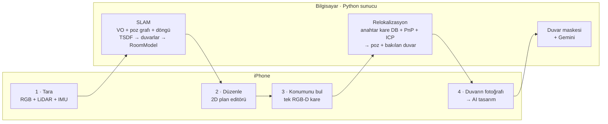
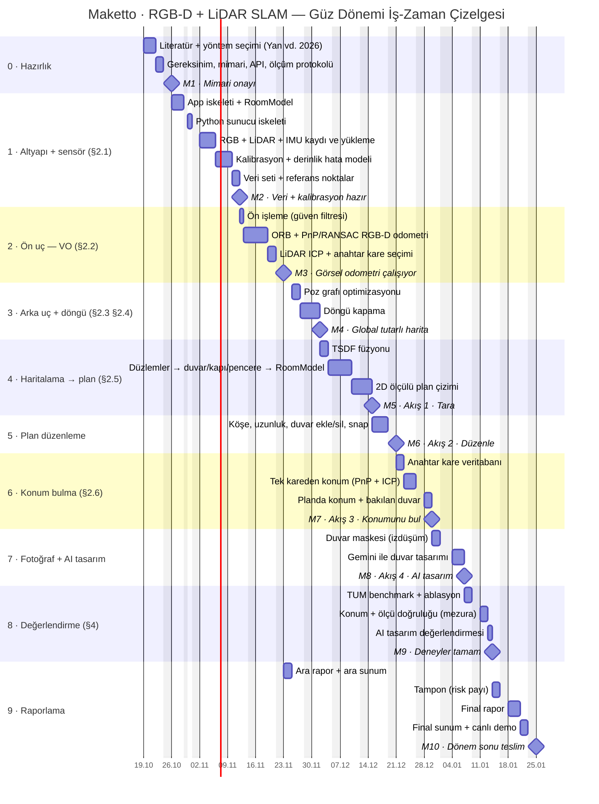

# Maketto — Güz Dönemi İş-Zaman Çizelgesi (Gantt)

- **Proje isteri:** RGB-D ve LiDAR ile SLAM
- **Referans makale:** Yan, Y.; Li, J.; Liu, Q.; Lv, S.; Wu, Q. *RGB-D SLAM: A Review of Methods and Performance Trade-Offs for Different Requirements.* Sensors 2026, 26(11), 3513. [doi:10.3390/s26113513](https://doi.org/10.3390/s26113513)
- **Proje:** Maketto — telefonla evi tara, planı düzenle, evin içinde konumunu haritada bul, bir duvarın fotoğrafını çek ve o duvar için AI tasarım al.

Plan, projeye sıfırdan başlanıyormuş gibi ve **tek bir üniversite dönemine (14 hafta)** sığacak şekilde kuruldu. SLAM, makaledeki RGB-D SLAM çerçevesinin modüllerine (§2.1–§2.6) bölündü. Her modül bir sonraki akış adımını mümkün kılıyor: harita **tara** adımını, relokalizasyon **konumunu bul** adımını, konum da AI tasarımın hangi duvara uygulanacağını belirliyor.

## Hedef akış

Fotoğraf çekildiğinde sunucu önce o karenin konumunu haritada bulur, sonra bakılan duvarı fotoğrafa izdüşürüp bir maske çıkarır. AI yalnızca o duvarı, gerçek ölçüleriyle yeniden tasarlar.

## Varsayımlar
- **Dönem:** 2026–27 güz dönemi, 19 Ekim 2026 (Pzt) → 22 Ocak 2027 (Cum), 14 hafta (H1–H14). Final sınav haftaları bu sürenin dışında.
- **Kapasite:** 68 iş günü (hafta sonları, 29 Ekim ve 1 Ocak hariç). Plan 68 iş gününün tamamını kullanıyor, 2 günlük tampon dahil. Sıkı bir plan.
- **Ekip:** Tek kişi, işler sırayla yapılıyor. Bir iş gecikirse teslim de kayar.
- **Mimari:** iPhone 14 Pro Max (RGB kamera + LiDAR dToF derinliği + IMU) veriyi toplar, planı düzenletir ve sonucu gösterir. SLAM, relokalizasyon ve AI çağrısı aynı ağdaki bir bilgisayarda Python sunucuda (FastAPI + OpenCV + Open3D) çalışır. AI tasarım için `PLAN.md`'deki Gemini görsel düzenleme API'si kullanılır.
- **Tarih kaydırma:** Yalnızca `lit` satırındaki başlangıç tarihini değiştirmek yeter, diğer her şey `after` bağımlılıklarıyla kayar. Bahar dönemine taşınırsa `excludes` satırına o dönemin tatilleri (Ramazan Bayramı 9–11 Mart, 23 Nisan, Kurban Bayramı 17–19 Mayıs) eklenmeli.

## Kapsam kararları
Makale (§5), zor koşullarda RGB-D SLAM'in gerçek zamandan çok doğruluk ve sağlamlığı öne aldığını söylüyor. Akıştaki hiçbir adım sürekli gerçek zaman gerektirmiyor: tarama bir kez işleniyor, konum her fotoğrafta tek kareden bulunuyor. Bu yüzden ağır hesap sunucuya alındı.

| Kapsam dışı | Neden |
|---|---|
| Cihazda gerçek zamanlı SLAM (Metal) | Bir döneme sığmıyor; akış için gerekmiyor |
| Sürekli canlı konum takibi | Konum, her sorguda (buton ya da fotoğraf) tek kareden bulunuyor |
| IMU füzyonu (§3.4) | İster RGB-D + LiDAR; IMU ek sensör. Veri zaten kaydediliyor (`cap`), sonra eklenebilir |
| Dinamik nesne filtreleme | Tarama boş odada yapılacak |
| Nöral örtük haritalama (NeRF, 3DGS) | Makale (§4) kısıtlı platformlarda önermiyor |
| Eşya yerleştirme, katalog, native 3B, çok odalı tarama (`PLAN.md` F4–F6) | Akışın parçası değil; sonraki dönem |
| RoomPlan ile karşılaştırma | Referans ölçüm mezurayla yapılıyor; zaman kalırsa eklenir |

## Gantt şeması
GitHub bu bloğu doğrudan çizer (dikey kırmızı çizgi bugünü gösterir). Rapor ve sunum için hazır görsel: [`docs/gantt.png`](docs/gantt.png).

> Mermaid, hafta sonuna denk gelen bitişleri çubuğa dahil eder ve kilometre taşını bir sonraki iş gününe çizer. Aşağıdaki tablolardaki tarihler gerçek iş günleridir.

## Kilometre taşları

| # | Kilometre taşı | Hafta | Tarih | Kanıt |
|---|---|---|---|---|
| M1 | Mimari onayı | H1 | 23 Ekim 2026 | Mimari doküman + yöntem karşılaştırması |
| M2 | Veri + kalibrasyon hazır | H4 | 11 Kasım 2026 | TUM formatında 5 sekans, 10 referans nokta, kalibrasyon raporu |
| M3 | Görsel odometri çalışıyor | H5 | 20 Kasım 2026 | TUM fr1/desk ATE RMSE < 5 cm; ardından ara rapor (24 Kasım) |
| M4 | Global tutarlı harita | H7 | 1 Aralık 2026 | Ev içi döngüde kapanış hatası < 5 cm |
| M5 | Akış 1 · Tara | H9 | 14 Aralık 2026 | Taramadan çıkan plan uygulamada, duvarlar mezurayla < 5 cm |
| M6 | Akış 2 · Düzenle | H9 | 18 Aralık 2026 | Düzenlenen plan kaydediliyor, harita koordinatları korunuyor |
| M7 | Akış 3 · Konumunu bul | H11 | 29 Aralık 2026 | Planda "buradasınız" + bakılan duvar |
| M8 | Akış 4 · AI tasarım | H12 | 6 Ocak 2027 | Duvar fotoğrafından maskeli AI tasarım |
| M9 | Deneyler tamam | H13 | 13 Ocak 2027 | Benchmark, konum doğruluğu ve AI değerlendirme tabloları |
| M10 | Dönem sonu teslim | H14 | 22 Ocak 2027 | Final rapor + canlı demo |

## Makale → iş paketi eşlemesi

| Makale | Konu | Plandaki karşılığı | Seçilen yaklaşım |
|---|---|---|---|
| §2.1 | RGB-D kamera, kalibrasyon | 1 · Altyapı + sensör | LiDAR (dToF) derinliği + RGB; hizalama doğrulaması, derinlik hata modeli |
| §2.2 | Ön uç (görsel odometri) | 2 · Ön uç | ORB + PnP/RANSAC; az dokulu duvarda LiDAR ICP |
| §2.3 | Arka uç | 3 · Arka uç + döngü | Filtre yerine poz grafı optimizasyonu |
| §2.4 | Döngü kapama | 3 · Arka uç + döngü | BoW / global tanımlayıcı + geometrik doğrulama |
| §2.5 | Haritalama | 4 · Haritalama → plan | TSDF → düzlemler → metrik + semantik `RoomModel` (duvar, kapı, pencere) |
| §2.6 | Relokalizasyon | 6 · Konum bulma | Anahtar kare DB + PnP + ICP; "konumunu bul" adımının kendisi |
| §3.4 | Çoklu sensör füzyonu | 2 · Ön uç | RGB öznitelikleri ile LiDAR geometrisi birlikte; IMU kapsam dışı |
| §4, Tablo 3–4 | Değerlendirme, ödünleşimler | 8 · Değerlendirme | ATE/RPE (TUM RGB-D), ablasyon, konum hatası, maske IoU |

**Yöntem seçiminin gerekçesi (makale §4):** Makale iç mekân ve statik sahne için öznitelik tabanlı yöntemleri (ORB-SLAM2/3 çizgisi), az dokulu sahneler için doğrudan/geometrik yöntemleri, büyük ölçek için LiDAR ya da IMU entegrasyonunu öneriyor. ORB tanımlayıcıları hem döngü kapamada hem relokalizasyonda yeniden kullanıldığı için ORB + LiDAR ICP + poz grafı hattı seçildi.

## İş paketleri
Süre iş günü (g) cinsinden; H, dönem haftasıdır.

### 0 · Hazırlık

| ID | İş paketi | Hafta | Tarih | Süre | Başarı ölçütü |
|---|---|---|---|---|---|
| `lit` | Literatür + yöntem seçimi (Yan vd. 2026) | H1 | 19 Eki – 21 Eki | 3 g | Makaledeki 5 paradigmanın (öznitelik, doğrudan, nöral örtük, hibrit, çoklu sensör) karşılaştırması + seçilen hattın gerekçesi |
| `req` | Gereksinim, mimari, API, ölçüm protokolü | H1 | 22 Eki – 23 Eki | 2 g | Mimari (iPhone istemci + Python sunucu: SLAM, relokalizasyon, AI), API sözleşmesi ve metrikler (ATE/RPE, konum hatası, maske IoU) yazılı |

### 1 · Altyapı + sensör (§2.1)

| ID | İş paketi | Hafta | Tarih | Süre | Başarı ölçütü |
|---|---|---|---|---|---|
| `f0` | App iskeleti + RoomModel | H2 | 26 Eki – 28 Eki | 3 g | Proje XcodeGen → Xcode → iPhone’da çalışıyor; RoomModel + SwiftData, mock oda listeleniyor |
| `srv` | Python sunucu iskeleti | H2 | 30 Eki | 1 g | FastAPI sunucusu; iPhone aynı ağdaki bilgisayara dosya yükleyip yanıt alıyor |
| `cap` | RGB + LiDAR + IMU kaydı ve yükleme | H3 | 02 Kas – 05 Kas | 4 g | RGB + 256×192 LiDAR derinlik + güven haritası + IMU + ARKit pozu ortak zaman damgasıyla TUM formatında kaydedilip sunucuya yükleniyor |
| `calib` | Kalibrasyon + derinlik hata modeli | H3–H4 | 06 Kas – 09 Kas | 2 g | İç parametreler doğrulandı, RGB↔derinlik hizalama hatası < 1 px, mesafeye bağlı derinlik hata modeli (0,3–5 m) |
| `data` | Veri seti + referans noktalar | H4 | 10 Kas – 11 Kas | 2 g | ≥ 5 sekans (oda, koridor, ev içi döngü, az dokulu duvar, düşük ışık), duvar ölçüleri (mezura) ve zemine işaretli 10 referans nokta |

### 2 · Ön uç — VO (§2.2)

| ID | İş paketi | Hafta | Tarih | Süre | Başarı ölçütü |
|---|---|---|---|---|---|
| `pre` | Ön işleme (güven filtresi) | H4 | 12 Kas | 1 g | Düşük güvenli ve uzak derinlik maskesi, delik doldurma |
| `vo` | ORB + PnP/RANSAC RGB-D odometri | H4–H5 | 13 Kas – 18 Kas | 4 g | ORB çıkarım/eşleme + derinlikle PnP/RANSAC; TUM fr1/desk ATE RMSE < 5 cm |
| `icp` | LiDAR ICP + anahtar kare seçimi | H5 | 19 Kas – 20 Kas | 2 g | Point-to-plane ICP (Open3D) ile az dokulu sekansta takip sürüyor; anahtar kare seçimi |

### 3 · Arka uç + döngü (§2.3 §2.4)

| ID | İş paketi | Hafta | Tarih | Süre | Başarı ölçütü |
|---|---|---|---|---|---|
| `pg` | Poz grafı optimizasyonu | H6 | 25 Kas – 26 Kas | 2 g | Anahtar kare düğümleri + VO/ICP kenarları, Open3D/g2o ile optimizasyon; ATE yalnız VO’ya göre düşüyor |
| `lc` | Döngü kapama | H6–H7 | 27 Kas – 01 Ara | 3 g | BoW ya da global tanımlayıcıyla aday + RANSAC/ICP doğrulama; ev içi döngüde kapanış hatası < 5 cm, yanlış döngü = 0 |

### 4 · Haritalama → plan (§2.5)

| ID | İş paketi | Hafta | Tarih | Süre | Başarı ölçütü |
|---|---|---|---|---|---|
| `tsdf` | TSDF füzyonu | H7 | 02 Ara – 03 Ara | 2 g | TSDF füzyonu (2 cm voksel) → yoğun nokta bulutu / mesh |
| `walls` | Düzlemler → duvar/kapı/pencere → RoomModel | H7–H8 | 04 Ara – 09 Ara | 4 g | RANSAC düzlem + Manhattan hizalama → duvar ve zemin, düzlemdeki boşluklardan kapı/pencere → RoomModel JSON; duvarlar mezurayla < 5 cm |
| `f2` | 2D ölçülü plan çizimi | H8–H9 | 10 Ara – 14 Ara | 3 g | RoomModel → doğru oranlı, ölçü etiketli 2D plan uygulamada çiziliyor |

### 5 · Plan düzenleme

| ID | İş paketi | Hafta | Tarih | Süre | Başarı ölçütü |
|---|---|---|---|---|---|
| `f3` | Köşe, uzunluk, duvar ekle/sil, snap | H9 | 15 Ara – 18 Ara | 4 g | Köşe sürükle, uzunluk yaz, duvar ekle/sil, snap; ölçüler tutarlı, harita koordinatları korunuyor |

### 6 · Konum bulma (§2.6)

| ID | İş paketi | Hafta | Tarih | Süre | Başarı ölçütü |
|---|---|---|---|---|---|
| `kfdb` | Anahtar kare veritabanı | H10 | 21 Ara – 22 Ara | 2 g | Anahtar karelerin ORB + global tanımlayıcıları ve optimize pozları haritayla birlikte kaydediliyor |
| `loc` | Tek kareden konum (PnP + ICP) | H10 | 23 Ara – 25 Ara | 3 g | Tek RGB-D kareden poz: aday anahtar kare → PnP/RANSAC → ICP iyileştirme; sorgu < 2 s |
| `here` | Planda konum + bakılan duvar | H11 | 28 Ara – 29 Ara | 2 g | Planda konum + yön oku; kameranın baktığı duvar ışın izlemeyle bulunuyor |

### 7 · Fotoğraf + AI tasarım

| ID | İş paketi | Hafta | Tarih | Süre | Başarı ölçütü |
|---|---|---|---|---|---|
| `mask` | Duvar maskesi (izdüşüm) | H11 | 30 Ara – 31 Ara | 2 g | Bakılan duvarın poligonu poz + iç parametrelerle fotoğrafa izdüşürülüyor → duvar maskesi |
| `ai` | Gemini ile duvar tasarımı | H12 | 04 Oca – 06 Oca | 3 g | Fotoğraf + duvar maskesi + ölçüler + stil istemi → Gemini görsel düzenleme; sonuç uygulamada gösterilip odaya kaydediliyor |

### 8 · Değerlendirme (§4)

| ID | İş paketi | Hafta | Tarih | Süre | Başarı ölçütü |
|---|---|---|---|---|---|
| `bench` | TUM benchmark + ablasyon | H12 | 07 Oca – 08 Oca | 2 g | TUM fr1/desk, fr2/xyz, fr3/long_office için ATE/RPE + ablasyon (yalnız RGB-D → +LiDAR ICP → +döngü kapama) |
| `reval` | Konum + ölçü doğruluğu (mezura) | H13 | 11 Oca – 12 Oca | 2 g | 10 referans noktada konum başarısı (hedef ≥ %90), konum hatası (< 10 cm), yön hatası (< 5°), maske IoU (≥ 0,8) + duvar ölçüleri tablosu |
| `aieval` | AI tasarım değerlendirmesi | H13 | 13 Oca | 1 g | 10 tasarımda yapı sadakati (kapı/pencere yerinde mi, duvar dışı bozulmuş mu) + 5 kişilik kullanıcı puanlaması |

### 9 · Raporlama

| ID | İş paketi | Hafta | Tarih | Süre | Başarı ölçütü |
|---|---|---|---|---|---|
| `int` | Ara rapor + ara sunum | H6 | 23 Kas – 24 Kas | 2 g | Literatür, mimari, sensör katmanı ve VO sonuçlarıyla ara rapor + ara sunum |
| `buf` | Tampon (risk payı) | H13 | 14 Oca – 15 Oca | 2 g | Kayan işler kapandı; bu noktadan sonra yeni özellik yok |
| `final` | Final rapor | H14 | 18 Oca – 20 Oca | 3 g | Yöntem, deneyler ve tartışma (makale §4’teki ödünleşimler üzerinden) |
| `demo` | Final sunum + canlı demo | H14 | 21 Oca – 22 Oca | 2 g | Canlı akış: evi tara → planı düzenle → konumunu bul → duvarın fotoğrafı → AI tasarım |

## Riskler

| Risk | Etki | Önlem |
|---|---|---|
| Tek kişilik, kapasitenin tamamını kullanan plan | Bir iş kayarsa teslim kayar | 2 g tampon (`buf`). Kayma tamponu aşarsa önce kullanıcı puanlaması (`aieval`), sonra ablasyon kısaltılır |
| Relokalizasyon başarısız (az doku, ışık farkı) | Konum bulunamaz, yanlış duvar seçilir | LiDAR ICP iyileştirme, birden fazla aday anahtar kare, kullanıcıya "biraz dön" ipucu |
| AI çıktısı yapıyı bozar (pencereyi siler, perspektifi değiştirir) | Tasarım odaya uymaz | Duvar maskesi + istemde ölçüler; yapı sadakati ölçülüyor (`aieval`) |
| Ev fotoğrafları dış servise gidiyor | Gizlilik | Kullanıcı onayı; yalnızca seçilen fotoğraf gönderiliyor |
| Cam, ayna ve parlak yüzeylerde LiDAR hatası (makale §4) | Hayalet duvar, ölçü hatası | Güven filtresi (`pre`), düzlem + Manhattan hizalama (`walls`) |
| Dar görüş alanı, ~5 m LiDAR menzili | Geniş alanda sürüklenme | Sık anahtar kare, döngü kapama (`lc`) |
| Ara sınav haftası ve diğer dersler | Haftalık kapasite düşer | Ara sınav haftası belli olunca o haftaya hafif işler (veri toplama, rapor) alınır |

---
PNG'yi yeniden üretmek için Gantt bloğunu <https://mermaid.live> adresine yapıştırıp dışa aktarın ya da:
`npx -p @mermaid-js/mermaid-cli mmdc -i GANTT.md -o docs/gantt.png -w 2000 -s 2 -b white` (akış şeması `docs/gantt-1.png`, Gantt şeması `docs/gantt-2.png` olarak yazılır; ikincisini `docs/gantt.png` adıyla kaydedin)
