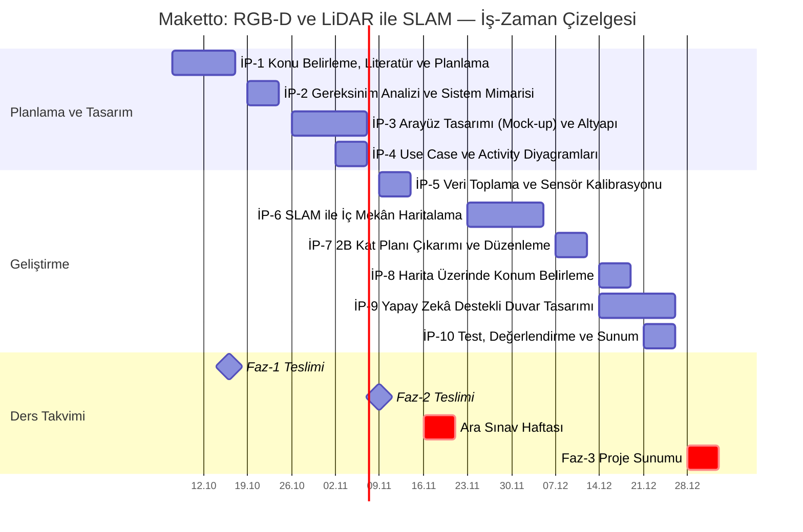

# Maketto — İş-Zaman Çizelgesi

## Proje Bilgileri

| | |
|---|---|
| **Ders** | Mobil Programlama (2026–2027 Güz Yarıyılı) |
| **Proje Konusu** | RGB-D ve LiDAR ile SLAM |
| **Proje Adı** | Maketto |
| **Proje Amacı** | Mobil cihazın RGB-D kamerası ve LiDAR sensörüyle iç mekânın haritasını çıkaran, kullanıcının bu harita üzerindeki konumunu belirleyen ve seçilen duvar için yapay zekâ destekli tasarım önerisi üreten bir mobil uygulama geliştirmek |
| **Proje Süresi** | 07.10.2026 – 01.01.2027 |
| **Referans Çalışma** | Yan, Y.; Li, J.; Liu, Q.; Lv, S.; Wu, Q. *RGB-D SLAM: A Review of Methods and Performance Trade-Offs for Different Requirements.* Sensors 2026, 26(11), 3513. [doi:10.3390/s26113513](https://doi.org/10.3390/s26113513) |

## Gantt Şeması

Rapor ve sunumlarda kullanılmak üzere görsel: [`docs/gantt.png`](docs/gantt.png)

## İş Paketleri

| İP | İş Paketi | Hafta | Tarih Aralığı | Çıktı |
|---|---|:---:|---|---|
| İP-1 | Proje konusunun belirlenmesi, literatür taraması ve iş-zaman planlaması | 2–3 | 07.10.2026 – 16.10.2026 | Proje tanımı ve Gantt şeması |
| İP-2 | Gereksinim analizi ve sistem mimarisinin tasarlanması | 4 | 19.10.2026 – 23.10.2026 | Gereksinim listesi ve sistem mimarisi şeması |
| İP-3 | Kullanıcı arayüzü tasarımı (mock-up) ve uygulama altyapısının kurulması | 5–6 | 26.10.2026 – 06.11.2026 | Ekran tasarımları ve ekranlar arası geçişler |
| İP-4 | Use Case ve Activity diyagramlarının hazırlanması | 6 | 02.11.2026 – 06.11.2026 | UML diyagramları ve fonksiyonel tanım raporu |
| İP-5 | RGB-D ve LiDAR verilerinin toplanması, sensör kalibrasyonu | 7 | 09.11.2026 – 13.11.2026 | Kalibre edilmiş tarama veri seti |
| İP-6 | SLAM algoritmasının geliştirilmesi ve iç mekânın haritalanması | 9–10 | 23.11.2026 – 04.12.2026 | İç mekânın üç boyutlu haritası |
| İP-7 | Haritadan iki boyutlu kat planı çıkarımı ve plan düzenleme modülü | 11 | 07.12.2026 – 11.12.2026 | Ölçülü ve düzenlenebilir kat planı |
| İP-8 | Harita üzerinde konum belirleme (relokalizasyon) | 12 | 14.12.2026 – 18.12.2026 | Kullanıcının plan üzerindeki konumu ve bakış yönü |
| İP-9 | Duvar görüntüsü üzerinden yapay zekâ destekli tasarım | 12–13 | 14.12.2026 – 25.12.2026 | Seçilen duvar için tasarım önerisi |
| İP-10 | Sistem testleri, performans değerlendirmesi ve sunum hazırlığı | 13 | 21.12.2026 – 25.12.2026 | Test raporu ve çalışır durumda uygulama |

## Teslim Takvimi

| Aşama | Hafta | Tarih | Kapsam |
|---|:---:|---|---|
| Faz-1 | 3 | 16.10.2026 | Gantt şeması ve proje planı |
| Faz-2 | 7 | 09.11.2026 | Mock-up, Use Case ve Activity diyagramları, fonksiyonel tanım |
| Ara Sınav | 8 | 16.11.2026 – 20.11.2026 | Bu hafta proje çalışmasına ara verilir |
| Faz-3 | 14 | 28.12.2026 – 01.01.2027 | Çalışır durumdaki uygulamanın teslimi ve yüz yüze sunumu |
